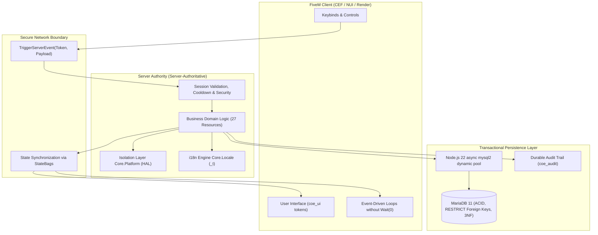

<p align="right">
  <b>🇺🇸 English</b> • <a href="README.pt-BR.md">🇧🇷 Português</a>
</p>

# COE Framework — Official Technical & Architecture Documentation

[](https://www.coeroleplay.app/)
[](https://docs.coeroleplay.app/)
[](https://docs.fivem.net/docs/server-download/?platform=enhanced&os=windows)
[](https://github.com/marcelomatz/coe-framework/actions)
[](INGAME_CHECKLIST.en-US.md)
[](I18N_LOCALIZATION.en-US.md)
[](PLATFORM_HAL.en-US.md)
[](PACKS.en-US.md)
[](https://docs.fivem.net/docs/server-download/?platform=enhanced&os=windows)
[](ARCHITECTURE.en-US.md)
[](#how-to-connect-coe-ai-agents-in-your-environment)

> **The Next Generation of FiveM Engineering**: an ecosystem engineered with **100% first-party code**, clean layered architecture, complete native isolation, and zero dependencies on legacy third-party frameworks.

> [!TIP]
> **💡 What is COE in plain English (for non-developers):**
> In the COE Framework, the server is the absolute single source of truth. Cheats and unauthorized state manipulations are blocked at the protocol level, your game server is shielded from thread hitch warnings and database freezes, and every UI natively adapts to the player's language — all crafted with AAA studio aesthetic quality.

---

## 💬 A Message from Marcelo Matz: Giving Back to the FiveM Community

> *"I have been working with software development for over 25 years. Throughout my entire career in technology, very few things have captivated me as deeply as the magic of roleplay and the boundless creativity of the FiveM community. Seeing hundreds of players simultaneously connected, weaving stories, creating cities, and sustaining vibrant communities through code is nothing short of inspiring.*
>
> *Releasing the **COE Framework** as open source is my humble way of giving back a portion of everything this wonderful community has given me over the years.*
>
> *I want to express my deepest respect and heartfelt gratitude to the pioneers and brilliant minds behind frameworks like **ESX**, **QBCore**, **Qbox**, and **Ox**. They laid the very foundation on which we all stand today, and they continue to do tireless, incredible work for the ecosystem. Likewise, my warmest thanks go out to every single **modder**, creator, and server administrator who dedicates their nights and weekends to making FiveM an ever-evolving, richer platform.*
>
> *The COE Framework is offered to the community with an open heart: 27 production-ready, fully tested resources built from a clean sheet with strict server-authoritative logic, 0.00ms idle resmon, a complete Platform HAL, and MariaDB 11 async pooling. May it serve as a reliable tool, a modern alternative, and an open foundation for our community to keep building the future of roleplay."*
>
> — **Marcelo Matz**

---

## 🖥️ Platform & Infrastructure Requirements (FiveM Enhanced / Cfx.re)

Verified and certified in accordance with official Cfx.re guidelines for **FiveM for GTAV Enhanced** ([`docs.fivem.net/docs/server-download/?platform=enhanced&os=windows`](https://docs.fivem.net/docs/server-download/?platform=enhanced&os=windows)):

| Component | Minimum Requirement | Recommended Production | Practical Meaning |
|---|---|---|---|
| **Cfx Server (FiveM Enhanced Artifacts)** | `Build 170+ (b170)` | `Build 170+ (b170 — Enhanced Track)` | The new **Cfx Server** engine (`cfx-server_win_x64.zip` / `cfx-server.exe` on Windows or `cfx-server_linux_x64.tar.xz` on Linux) built specifically for **FiveM for GTAV Enhanced**. |
| **GTA V Enhanced Game Build** | `Native Gen9 / DirectX 12` | `Latest Enhanced Build (Automatic)` | FiveM Enhanced does **not** use legacy `sv_enforceGameBuild` numbers (`3095`/`3258`). The server automatically mounts the latest GTA V Enhanced build with all DLCs active. |
| **Runtime & Language** | Node.js 22 LTS | Node.js 22 LTS & Native Lua 5.4 | Ultra-fast non-blocking execution without memory bloat or main-thread bottlenecks. |
| **Relational Database** | MariaDB 11.x | MariaDB 11.x (`utf8mb4_unicode_ci`) | Atomic persistence ensuring that money, inventory transactions, and vehicle states are safely committed with zero rollback. |

---

## 🚀 Beginner's Step-by-Step Guide: How to Use the COE Framework for the First Time

New to setting up a **FiveM for GTAV Enhanced** server or migrating from older bases? Follow this simple walkthrough from scratch to walking around your city:

### Step 1 — Download the Base Software on Your PC or VPS
1. **Database (MariaDB 11)**: Download and install [MariaDB 11.x](https://mariadb.org/download/) (check the option to install *HeidiSQL* and write down your `root` password).
2. **FiveM Enhanced Server (`Build b170+`)**:
   - Visit the official Cfx.re download page: [**Server Download — FiveM for GTAV Enhanced (Windows)**](https://docs.fivem.net/docs/server-download/?platform=enhanced&os=windows).
   - Ensure the **Platform** selector is set to **`FiveM for GTAV Enhanced`** and download **`cfx-server_win_x64.zip`** (`build 170` or newer).
   - Create a dedicated folder for your server (e.g., `C:\MyCOEServer\server`) and extract the `.zip` contents into it.

### Step 2 — Install the COE Framework in 1 Click via txAdmin (Recommended)
1. Open the folder where you extracted the server and double-click **`cfx-server.exe`** (in FiveM Enhanced, this replaces the old `FXServer.exe`).
2. Your browser will automatically open the **txAdmin** setup wizard (usually at `http://localhost:40120`) with a 4-digit PIN displayed in your terminal.
3. Link your Cfx.re account and, under **Deployment Type**, select **`Remote URL Template`**.
4. Paste the official COE Framework recipe URL:
   ```text
   https://www.coeroleplay.app/recipe.yaml
   ```
5. Enter your **MariaDB** password and your Cfx.re license key ([Cfx.re Portal / Keymaster](https://portal.cfx.re/)).
6. Click **Run Recipe**! txAdmin will handle everything automatically: downloading the default Cfx.re resources, pulling all **27 open-source COE Framework resources**, provisioning the database schema, and launching your server!

> [!TIP]
> **Prefer manual installation or using the full developer workspace?**
> - **Manual via Git**: Clone `https://github.com/marcelomatz/coe-framework.git` into `resources/[coe-framework]` and add `ensure coe_supervisor` and `ensure [coe-framework]` to your `server.cfg`.
> - **Workspace CLI (`coe.ps1`)**: From the workspace root, run `.\coe.ps1 dev enable framework` and `.\coe.ps1 dev sync-cfg` in PowerShell to link resources instantly via NTFS junctions.

### Step 3 — Join Your City and Test Your First Commands
1. Launch your **FiveM for GTA V Enhanced** client (make sure GTA V Enhanced is installed via Steam/Epic/Rockstar Launcher) and connect to your server (`F8` ➔ `connect localhost`).
2. Create your first character in the 3D scene (`coe_characters` and `coe_appearance`) and pick your arrival location (`coe_spawn`).
3. Try out the native city shortcuts and commands:
   - **`I`**: Opens and closes the grid slot inventory (`coe_inventory`).
   - **`TAB` and `1`–`5`**: Previews the quick-access Hotbar (`TAB`) and uses items in slots `1` to `5` (press **`X`** to cancel an active item consumption).
   - **`ALT` (hold)**: Activates 3D eye-targeting (`coetarget`) to interact with ATMs, 24/7 stores, vehicles, and NPCs.
   - **`F1` or `/telefone`**: Opens the basic phone (`coe_mobile`).
   - **`F3` or `/trabalho`**: Opens the workpad and career tablet (`coe_workpad`).
   - **`Z` and `M`**: Toggles the expanded radar minimap (`Z`) or opens the full map (`M` / `/destino`, `coe_map`).
   - **`B`, `H`, and `←` `→`**: Inside a vehicle, toggles seatbelt (`B`), headlights (`H`), and turn signals (`coe_hud`).
   - **`N`, `CAPS LOCK`, and `PgUp`/`PgDn`**: Speaks on mic (`N`), on radio (`CAPS`), and cycles voice range (`coe_talk`).
   - **`F10` or `/staff`**: Opens the staff administration panel (`coe_staff` — automatically granted to the txAdmin admin).
   - **`/id` and `/saldo`**: Displays your public Citizen ID (`stateId`) and bank balance (`coe_economy`).
   - **`/hud`**: Customizes the speedometer and switches between all **5 visual themes** and languages (`en-US` / `pt-BR`) in real time!

---

## 🤖 How to Connect COE AI Agents in Your Environment

The **COE Framework** was designed from day one to work hand-in-hand with **Artificial Intelligence**. The ecosystem ships with a dedicated agent directory (`.agents/`) featuring **5 Architectural Rules (`rules/`)** and **8 Specialized Skills (`skills/`)**, alongside the **COE AI Toolkit** built into this documentation portal.

With the agents connected, even if you are **not an experienced programmer**, you can ask the AI in plain language to create new jobs, stores, HTML/CSS panels, database tables, and automated tests — and the AI will generate 100% compliant, secure code running at **0.00 ms idle**.

### Option A — Using an Agentic IDE (Antigravity IDE, Cursor, VS Code + Copilot / Cline / Windsurf)

1. **Open the workspace root folder in your editor**:
   Ensure the **`.agents/`** folder sits at the root of your project (e.g., `d:\coe-enhanced\.agents`).
   - In **Google Antigravity**, the rules in `.agents/rules/*.md` and skills in `.agents/skills/*/SKILL.md` are **automatically discovered and activated** as soon as you open the workspace!
   - In **Cursor IDE**, **VS Code (GitHub Copilot)**, or **Claude Code**, point your *Rules for AI* / *Custom Instructions* to `.agents/rules/` (or copy `.agents/rules/00-coe-essencial.md` into `.cursorrules` / `CLAUDE.md`).

2. **Meet the 5 Automatic Rules (`rules/`) protecting your server**:
   Whenever you chat with the AI, these rules prevent it from hallucinating legacy code (ESX/QBCore) or introducing security flaws:

   | Rule (`.agents/rules/`) | What it automatically teaches your AI |
   |---|---|
   | `00-coe-essencial.md` | Workspace map, the 10 non-negotiable rules (Server-Authoritative, open-core boundary, zero legacy code), and CI validation commands. |
   | `coe-seguranca-servidor.md` | Anti-exploit protection on net events, rate-limiting, server-side 3D distance checks, atomic locks, and ACE permissions. |
   | `coe-lua-estilo.md` | Official layered anatomy (`domain/`, `adapters/`, `application/`, `client.lua`), `fxmanifest.lua`, and `types.lua` contracts. |
   | `coe-persistencia.md` | Asynchronous `coe_database` usage with MariaDB 11, parameterized queries (`?`), and idempotent schema migrations. |
   | `coe-i18n-nui.md` | Mandatory `pt-BR`/`en-US` localization with 100% parity and NUI creation using the 5 themes of the `coe_ui` design system. |

3. **Trigger the 8 Skills (`skills/`) to generate new scripts and resources**:
   The agents include 8 specialized workflows with scaffolding scripts and tested templates:

   | Skill (`.agents/skills/`) | What it does (in plain English) |
   |---|---|
   | **`coe-novo-resource`** | Scaffolds a brand-new script/resource from scratch with clean layers, database setup, pt-BR/en-US locales, and passing unit tests. |
   | **`coe-evento-rede`** | Implements a player action (buying, collecting, using an item, `ALT` target interaction) shielded against cheaters and item duping. |
   | **`coe-interface-nui`** | Builds sleek screens, menus, HUDs, or tablet apps reusing the 5 official `coe_ui` themes. |
   | **`coe-migracao-db`** | Creates or alters MariaDB database tables safely without losing existing player data. |
   | **`coe-export-contrato`** | Exposes public functions (`exports`) so scripts can communicate with full LuaLS type safety and generated reference docs. |
   | **`coe-teste-unitario`** | Writes offline unit tests that run in milliseconds in your terminal without needing to launch GTA V. |
   | **`coe-servidor-dev`** | Enables your newly created script on your local server (`.\coe.ps1 dev enable`) and guides you through in-game testing. |
   | **`coe-validar-ci`** | Runs the official COE quality pipeline across your code to guarantee zero errors before going live. |

4. **Practical prompt examples to ask your AI Agent (Copy & Try!)**:
   Simply open your editor's AI chat and type requests like:
   - 💬 **To create a complete system from scratch**:
     > *"Use the `coe-novo-resource` skill to create a new resource called `coe_fishing` in `coe-framework`. Let players buy a fishing rod, use `coetarget` near the pier to catch fish, receive fish in `coe_inventory`, and sell fish for bank money via `coe_economy`. Include pt-BR and en-US locales and run the CI validation at the end."*
   - 💬 **To build a visual interface (NUI)**:
     > *"Use the `coe-interface-nui` skill to add a top anglers leaderboard panel to `coe_fishing`, following `coe_ui` design tokens and all 5 themes."*
   - 💬 **To enable and test on your local server**:
     > *"Use the `coe-servidor-dev` skill to enable `coe_fishing` on my local server, configure the required ACE permissions in `server.cfg`, and tell me how to test it in-game."*

### Option B — Using ChatGPT, Claude Web, or Browser-Based AIs

If you are using a web-based AI assistant without opening a local workspace:
1. At the top of any page on [**docs.coeroleplay.app**](https://docs.coeroleplay.app/), click the **"Copy for AI"** button (or visit the **🤖 AI & Devs** tab on the portal homepage).
2. Click **Copy System Prompt** and **Copy Context Bundle** and paste them into your ChatGPT or Claude conversation.
3. Describe the script you want to build — the AI will immediately know all `exports` signatures, security rules, and file conventions of the COE Framework!

---

## 🧭 What is the COE Framework?

The **COE Framework** is a software engineering solution built from a blank slate to power high-concurrency, high-performance FiveM servers:

Built from the ground up, the framework introduces modern software engineering practices to FiveM, standing alongside respected ecosystems such as ESX, QBCore, and Qbox:

1. **100% First-Party & Integrated Architecture**: Rather than relying on disparate wrappers, all resources communicate through formal, type-safe Lua 5.4 export contracts.
2. **Strict Server-Authoritative Authority**: The client never dictates cash balances, inventory slots, vehicle permissions, or admin states. Every client action is an intent evaluated by the server before applying to the world.
3. **Platform Abstraction Layer (`Core.Platform` / HAL)**: Domain business logic is completely isolated from raw CFX/FiveM C++ natives, preventing platform breaking changes and enabling sub-millisecond offline unit testing.
4. **End-to-End Internationalization (`Core.Locale`)**: Fully asynchronous per-player multi-language localization (`en-US` and `pt-BR` with 100% key parity across 445 audited keys).
5. **Concurrent Relational Persistence (MariaDB 11 + Node.js 22)**: Dynamic non-blocking connection pooling, idempotent schema migrations (`coe_migrations`), and relational constraints (`RESTRICT`).

---

## ⚙️ How Does COE Work? (Core Architectural Pillars)



### 1. Server-Authoritative Architecture
In conventional scripts, clients frequently execute sensitive events such as `TriggerServerEvent('giveMoney', 5000)` or compute transaction outcomes locally. In the COE Framework:
- The client only transmits **player intent** (e.g., "player pressed E to refuel", "player requested moving an item from slot 1 to slot 3");
- The server validates spatial coordinates, distance, item availability, bank balance, and permissions;
- The server writes changes atomically to MariaDB and broadcasts state changes to verified clients via `StateBags` or directed events;
- Malicious payloads trigger immediate rejection and are logged to the durable audit trail ([`coe_audit`](coe_audit)).

### 2. CFX Platform Layer (`Core.Platform` / HAL)
Raw C++ natives provided by the CFX runtime (`GetEntityCoords`, `DeleteEntity`, `SetVehicleNumberPlateText`, `SetPlayerRoutingBucket`, etc.) are prone to deprecation and engine signature changes.

The [`@coe_core/lib/platform.lua`](PLATFORM_HAL.en-US.md) module acts as an **Anti-Corruption Layer (ACL)**:
- Encapsulates raw natives inside typed object-oriented contracts (`CoePlatformVehicle`, `CoePlatformPed`, `CoePlatformPlayer`);
- Provides an automated in-memory mock backend enabled outside FXServer for fast offline terminal testing;
- CI pipelines strictly enforce zero raw natives in migrated domain scripts via `--audit-natives`.

### 3. Rigorous Localization (`Core.Locale` / i18n)
- Player-facing strings reside exclusively in `locales/en-us.lua` and `locales/pt-br.lua`;
- The `Core.Locale` engine supports key-interpolated (`%{param}`) and positional (`%s`) formatting with dynamic multi-currency rendering (`$`, `€`, `R$`);
- **Anti-MsgPack Isolation**: Libraries are loaded locally within each resource via `LoadResourceFile` in `@coe_core/lib/init.lua`, preventing metatable loss caused by FiveM export serialization (`attempt to call a table value (local '_t')`);
- Automated CI linters block any Pull Request that introduces hardcoded literal notification strings.

### 4. Non-Blocking Persistence & Safe Write-Behind
- **Zero Synchronous Main-Thread Stalls**: All database queries execute via the asynchronous `coe_database` provider on Node.js 22 LTS;
- **Smart Write-Behind Inventory Caching**: High-frequency slot transfers between stashes and player pockets are validated in memory with periodic flushed batch persistence (`Config.Server.flushIntervalMs`), eliminating I/O bottlenecks during peak server concurrency without risk of item duping;
- **Idempotent Atomic Migrations**: Each database-enabled resource manages its own schema migration definitions, executed idempotently on boot.

---

## ⚖️ Comparative Overview: COE Framework vs. Legacy Frameworks

| Technical Criterion | Legacy Frameworks (ESX / vRP) | QBCore / Qbox | COE Framework (Enhanced) |
|---|---|---|---|
| **Architecture** | Monolithic loops | Modular with external dependencies | **Strict 8 Layer Clean Architecture (First-Party)** |
| **Idle CPU Resmon** | `1.5ms – 3.5ms` idle | `0.8ms – 2.0ms` | **`0.00ms – 0.05ms` per module (< 0.15ms total)** |
| **Security Model** | Client-trusting (vulnerable to Lua injectors) | Partial callback verification | **Strict Server-Authoritative + Durable Audit (`coe_audit`)** |
| **Database Engine** | Synchronous blocking queries | Lua wrappers or heavier ORMs | **Node.js 22 Async, MariaDB 11 Pool, Zero Hitch** |
| **Relational Integrity** | Unindexed JSON blobs | Semi-structured JSON in columns | **3NF Relational Model, `RESTRICT` Constraints, Migrations** |
| **Platform Target** | Legacy FiveM DX11 | Legacy FiveM DX11 | **FiveM for GTA V Enhanced (Pure)** |
| **Native Decoupling** | None (direct natives in scripts) | None (direct natives) | **Platform HAL Layer (`Core.Platform`) with Mocking** |
| **Internationalization** | Mixed languages or untranslated | Partial loose locale files | **100% Migrated (`Core.Locale`), 445 keys, 100% Parity** |
| **Automated Testing** | None (in-game trial and error) | Minimal unit tests | **118 Unit Tests, 30 Smoke Boot Tests, 100% Green CI** |
| **Code Annotations** | Untyped dynamic Lua | Partial LuaLS annotations | **Formal LuaLS typed contracts (`types.lua`)** |
| **Design System** | Unstyled / Legacy jQuery | Varied disparate web templates | **Unified Design Tokens (`tokens.css`) with 5 Dynamic Themes** |

---

## 🛠️ For FiveM Community Developers: Building Custom Scripts

The COE Framework is committed to empowering FiveM developers and modders. You never need to fork or hack the core framework to create custom jobs, businesses, missions, or minigames:

- **100% MIT Open Source**: 27 standalone resources you can explore, extend, and deploy for free.
- **Runtime Extension Points**: Register new corporate tablet tabs (`coe_businesses:RegisterTab`), payment providers (`coe_shops:RegisterPaymentMethod`), and custom items (`coe_inventory:RegisterItem`) without modifying framework files.
- **FiveM ACE Security**: Grant fine-grained permissions via `add_ace resource.<name> coe.<capability> allow`.

👉 **Read the comprehensive tutorial**: [`DEVELOPER_GUIDE.en-US.md`](DEVELOPER_GUIDE.en-US.md) (or [Versão em Português](DEVELOPER_GUIDE.md)) with 5 complete production-ready examples (Interactions, 3D Targeting, MariaDB 11, Economy/Inventory, and Extension Points).

---

## 📚 Ecosystem Documentation Index

| Document | Topic & Focus |
|---|---|
| [`DEVELOPER_GUIDE.en-US.md`](DEVELOPER_GUIDE.en-US.md) ([`pt-BR`](DEVELOPER_GUIDE.md)) | **Developer Guide**: Complete manual with practical examples for creating scripts on COE Core. |
| [`ARCHITECTURE.en-US.md`](ARCHITECTURE.en-US.md) | **Technical Architecture**: Deep dive into the 8 layers, database lifecycles, and export contracts. |
| [`PACKS.en-US.md`](PACKS.en-US.md) | **Open Modules**: Detailed catalog of the 27 open-source resources under MIT license. |
| [`LICENSING.en-US.md`](LICENSING.en-US.md) | **Governance & Licensing**: Open Core model (MIT on GitHub) and Contributor License Agreement guidelines. |
| [`PLATFORM_HAL.en-US.md`](PLATFORM_HAL.en-US.md) | **Platform HAL**: CFX native isolation, entity adapters, and test mock backend. |
| [`I18N_LOCALIZATION.en-US.md`](I18N_LOCALIZATION.en-US.md) | **Internationalization**: `Core.Locale` guide, dictionary syntax, dynamic NUI translation, and CI linter. |
| [`ROADMAP.en-US.md`](ROADMAP.en-US.md) | **Ecosystem Roadmap**: Completed milestones (Waves 1–4 of i18n, HAL, Smoke Boot) and ongoing tasks. |
| [`INGAME_CHECKLIST.en-US.md`](INGAME_CHECKLIST.en-US.md) | **Verification Checklist**: 50 live in-game scenarios and benchmarking guidelines. |
| [`COMMUNITY_RELEASE.en-US.md`](COMMUNITY_RELEASE.en-US.md) | **Community Announcements**: Official release post templates for the Cfx.re forums and Discord. |

---

## 🌐 Official Repositories

* **Open-Source Framework**: [https://github.com/marcelomatz/coe-framework](https://github.com/marcelomatz/coe-framework)
* **Documentation & Guides**: [https://github.com/marcelomatz/coe-docs](https://github.com/marcelomatz/coe-docs)
* **Website**: [https://github.com/marcelomatz/coe-enhanced-website](https://github.com/marcelomatz/coe-enhanced-website)
