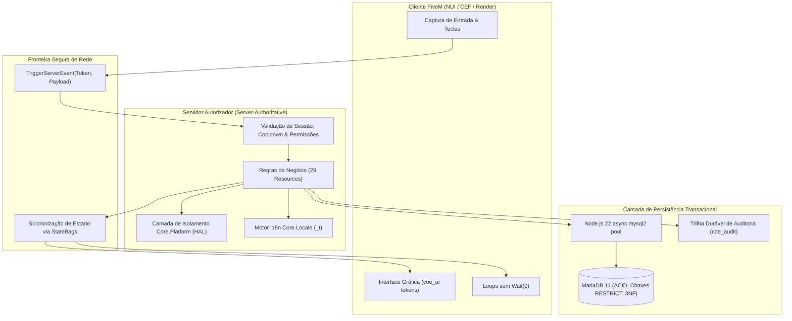

<p align="right">
  <a href="README.md">🇺🇸 English</a> • <b>🇧🇷 Português</b>
</p>

# COE Framework — Documentação Técnica & Arquitetura Oficial

[](https://www.coeroleplay.app/)
[](https://docs.coeroleplay.app/)
[](https://docs.fivem.net/docs/server-download/?platform=enhanced&os=windows)
[](https://github.com/marcelomatz/coe-framework/actions)
[](#garantia-de-qualidade-e-anti-regressao-no-ci)
[](https://docs.coeroleplay.app/#doc=I18N_LOCALIZATION.md)
[](https://docs.coeroleplay.app/#doc=PLATFORM_HAL.md)
[](https://docs.coeroleplay.app/#doc=PACKS.md)
[](https://docs.fivem.net/docs/server-download/?platform=enhanced&os=windows)
[](https://docs.coeroleplay.app/#doc=ARCHITECTURE.md)
[](#como-conectar-os-agentes-de-ia-do-coe-no-seu-ambiente)

> **A Nova Geração da Engenharia FiveM**: o primeiro ecossistema para servidores FiveM Enhanced do Brasil construído com **100% de código autoral**, arquitetura limpa em camadas, isolamento total de natives e zero dependências de bibliotecas ou frameworks legados do mercado.

> [!TIP]
> **💡 O que é o COE em termos simples (para não programadores):**
> No COE, o servidor tem o controle absoluto de tudo o que acontece na cidade. Trapaças e programas ilegais são bloqueados na raiz, a cidade não sofre com aqueles "congelamentos" comuns de banco de dados, e a interface fala o idioma nativo de cada jogador — tudo desenhado com um padrão estético de estúdio AAA.

---

## 💬 Uma Mensagem de Marcelo Matz: Devolvendo à Comunidade FiveM

> *"Trabalho com desenvolvimento de software há mais de 25 anos. Ao longo de toda a minha trajetória na tecnologia, poucas coisas me fascinaram tanto quanto a mágica do roleplay e o poder criativo do FiveM. Ver centenas de pessoas conectadas simultaneamente, construindo histórias, cidades e comunidades inteiras em cima de código é algo verdadeiramente inspirador.*
>
> *Hoje, a disponibilização do **COE Framework** em código aberto é a minha forma de começar a devolver um pouco de tudo aquilo que essa comunidade já me proporcionou ao longo dos anos.*
>
> *Quero deixar registrado o meu mais profundo respeito e gratidão a todos os pioneiros e desenvolvedores de frameworks como **ESX**, **QBCore**, **Qbox** e **Ox**, que desbravaram caminhos, criaram os alicerces onde todos nós pisamos e continuam fazendo um trabalho admirável pelo ecossistema. Da mesma forma, meu agradecimento sincero a cada **modder**, criador de conteúdo e administrador de servidor que dedica noites e fins de semana para tornar o ambiente do FiveM cada vez melhor.*
>
> *O COE Framework nasce como uma contribuição de coração aberto: 29 resources em arquitetura limpa, com desempenho inegociável (0.00ms idle), totalmente orientados ao servidor, desacoplados via Platform HAL e com banco assíncrono MariaDB 11. Que ele sirva como ferramenta, inspiração e base sólida para que a comunidade continue criando o futuro do roleplay."*
>
> — **Marcelo Matz**

---

## 🖥️ Requisitos de Infraestrutura & Homologação de Plataforma (FiveM Enhanced)

Verificado e homologado conforme a página oficial de downloads da Cfx.re para **FiveM for GTAV Enhanced** ([`docs.fivem.net/docs/server-download/?platform=enhanced&os=windows`](https://docs.fivem.net/docs/server-download/?platform=enhanced&os=windows)):

| Componente | Requisito Mínimo | Versão Recomendada (Produção) | O que significa na prática? |
|---|---|---|---|
| **Cfx Server (FiveM Enhanced Artifacts)** | `Build 170+ (b170)` | `Build 170+ (b170 — Track Enhanced)` | É o novo motor **Cfx Server** (`cfx-server_win_x64.zip` / `cfx-server.exe` no Windows ou `cfx-server_linux_x64.tar.xz` no Linux) exclusivo para a plataforma **FiveM for GTAV Enhanced**. |
| **GTA V Enhanced Game Build** | `Gen9 / DirectX 12 Nativo` | `Última Build Enhanced (Automática)` | No FiveM Enhanced **não se usa** números antigos de `sv_enforceGameBuild` do Legacy (`3095`/`3258`). O servidor carrega automaticamente a build mais recente do GTA V Enhanced com todas as DLCs ativas. |
| **Runtime & Linguagem** | Node.js 22 LTS | Node.js 22 LTS & Lua 5.4 nativo | Execução ultra-rápida de código sem acúmulo de memória e sem travar a main-thread do servidor. |
| **Banco de Dados Relacional** | MariaDB 11.x | MariaDB 11.x (`utf8mb4_unicode_ci`) | O cofre de dados que grava finanças e inventários de forma atômica, eliminando duplicações de itens. |

---

## 🚀 Passo a Passo para Iniciantes (Usuários Leigos): Como Usar o COE Framework pela Primeira Vez

Nunca montou um servidor no **FiveM for GTAV Enhanced** ou está vindo de bases antigas? Siga este roteiro simples do zero até entrar na sua cidade:

### Passo 1 — Baixe os Programas Base no seu Computador ou VPS
1. **Banco de Dados (MariaDB 11)**: Baixe e instale o [MariaDB 11.x](https://mariadb.org/download/) (durante a instalação, marque para instalar o *HeidiSQL* e anote a senha do usuário `root`).
2. **Servidor FiveM Enhanced (`Build b170+`)**:
   - Acesse a página oficial da Cfx.re: [**Server Download — FiveM for GTAV Enhanced (Windows)**](https://docs.fivem.net/docs/server-download/?platform=enhanced&os=windows).
   - Certifique-se de que o seletor **Platform** está em **`FiveM for GTAV Enhanced`** e baixe o pacote **`cfx-server_win_x64.zip`** (`build 170` ou superior).
   - Crie uma pasta para o seu servidor (ex.: `C:\MeuServidorCOE\server`) e extraia todo o conteúdo do `.zip` dentro dela.

### Passo 2 — Instale o COE Framework em 1 Clique pelo txAdmin (Recomendado)
1. Dentro da pasta onde você extraiu o servidor, dê dois cliques no executável **`cfx-server.exe`** (no FiveM Enhanced ele substitui o antigo `FXServer.exe`).
2. O navegador abrirá automaticamente o painel do **txAdmin** (geralmente em `http://localhost:40120`) com um código PIN de 4 dígitos exibido no terminal.
3. Vincule sua conta Cfx.re e, na etapa **Deployment Type (Tipo de Implantação)**, escolha a opção **`Remote URL Template`** (Receita por URL Remota).
4. Cole a URL oficial da receita do COE Framework:
   ```text
   https://www.coeroleplay.app/recipe.yaml
   ```
5. Informe a senha do seu **MariaDB** e a sua chave de licença Cfx.re ([Keymaster / Portal Cfx.re](https://portal.cfx.re/)).
6. Clique em **Run Recipe (Executar Receita)**! O txAdmin fará tudo sozinho: baixará os resources padrão da Cfx.re, baixará os **29 resources abertos do COE Framework**, criará o banco de dados com todas as tabelas automaticamente e iniciará o servidor!

> [!TIP]
> **Prefere instalar manualmente ou usar o ambiente completo de desenvolvimento?**
> - **Manual via Git**: Clone `https://github.com/marcelomatz/coe-framework.git` dentro de `resources/[coe-framework]` e adicione `ensure coe_supervisor` e `ensure [coe-framework]` no seu `server.cfg`.
> - **Workspace com CLI (`coe.ps1`)**: Na raiz do ecossistema, execute `.\coe.ps1 dev enable framework` e `.\coe.ps1 dev sync-cfg` no PowerShell para ativar os resources via links instantâneos (junctions NTFS).

### Passo 3 — Entre na Cidade e Teste seus Primeiros Comandos
1. Abra o seu cliente **FiveM for GTA V Enhanced** (certifique-se de ter o GTA V Enhanced instalado na Steam/Epic/Rockstar Launcher) e conecte-se ao seu servidor (`F8` ➔ `connect localhost`).
2. Crie o seu primeiro personagem na cena 3D (`coe_characters` e `coe_appearance`) e escolha o local de chegada (`coe_spawn`).
3. Experimente os atalhos nativos da cidade:
   - **`I`**: Abre e fecha o inventário em grade (`coe_inventory`).
   - **`TAB` e `1`–`5`**: Exibe a barra rápida (Hotbar) na tela (`TAB`) e usa os itens dos slots `1` a `5` (pressione **`X`** para cancelar um consumo em andamento).
   - **`ALT` (segurar)**: Ativa o olho de interação 3D (`coetarget`) para interagir com caixas eletrônicos, lojas 24/7, veículos e NPCs.
   - **`F1` ou `/telefone`**: Abre o celular (`coe_mobile`).
   - **`F3` ou `/trabalho`**: Abre o tablet de trabalho e carreira (`coe_workpad`).
   - **`Z` e `M`**: Alterna o minimapa expandido (`Z`) ou abre o mapa completo (`M` / `/destino`, `coe_map`).
   - **`B`, `H` e `←` `→`**: No veículo, afivela o cinto (`B`), alterna os faróis (`H`) e aciona as setas (`coe_hud`).
   - **`N`, `CAPS LOCK` e `PgUp`/`PgDn`**: Fala no microfone (`N`), no rádio (`CAPS`) e ajusta o alcance da voz (`coe_talk`).
   - **`F10` ou `/staff`**: Abre o painel administrativo da staff (`coe_staff` — liberado automaticamente para o admin configurado no txAdmin).
   - **`/id` e `/saldo`**: Consulta seu ID público de cidadão (`stateId`) e seu saldo bancário (`coe_economy`).
   - **`/hud`**: Personaliza o velocímetro e alterna entre os **5 temas visuais** e idiomas (`pt-BR` / `en-US`) em tempo real!

---

## 🤖 Como Conectar os Agentes de IA do COE no Seu Ambiente

O **COE Framework** foi projetado desde o primeiro dia para trabalhar em conjunto com **Inteligência Artificial**. O ecossistema inclui uma pasta dedicada de agentes (`.agents/`) com **5 Regras Arquiteturais (`rules/`)** e **8 Habilidades Especializadas (`skills/`)**, além do **COE AI Toolkit** integrado neste portal de documentação.

Com os agentes conectados, mesmo que você **não seja um programador experiente**, você pode pedir em português claro para a IA criar novos empregos, lojas, painéis HTML/CSS, tabelas no banco de dados e testes automatizados — e a IA gerará código 100% compatível, seguro e com **0.00 ms em idle**.

### Opção A — Usando um Editor com Agentes (Antigravity IDE, Cursor, VS Code + Copilot / Cline / Windsurf)

1. **Abra a pasta raiz do workspace no seu editor**:
   Certifique-se de que a pasta **`.agents/`** esteja na raiz do seu projeto (ex.: `d:\coe-enhanced\.agents`).
   - No **Google Antigravity**, as regras em `.agents/rules/*.md` e as skills em `.agents/skills/*/SKILL.md` são **detectadas e carregadas automaticamente** assim que você abre a pasta!
   - No **Cursor IDE**, **VS Code (GitHub Copilot)** ou **Claude Code**, aponte as configurações de *Rules for AI* / *Custom Instructions* para a pasta `.agents/rules/` (ou copie o conteúdo de `.agents/rules/00-coe-essencial.md` para o seu arquivo `.cursorrules` / `CLAUDE.md`).

2. **Conheça as 5 Regras Automáticas (`rules/`) que protegem seu servidor**:
   Sempre que você conversa com a IA, essas regras impedem que ela invente código legado (ESX/QBCore) ou crie brechas de segurança:

   | Regra (`.agents/rules/`) | O que ela ensina automaticamente para a IA |
   |---|---|
   | `00-coe-essencial.md` | Mapa do ecossistema, as 10 regras inegociáveis (Server-Authoritative, fronteira open-core, zero código legado) e comandos de validação. |
   | `coe-seguranca-servidor.md` | Proteção anti-exploit em eventos de rede, rate-limit, checagem de distância 3D no servidor, travas atômicas e permissões ACE. |
   | `coe-lua-estilo.md` | Anatomia oficial em camadas (`domain/`, `adapters/`, `application/`, `client.lua`), `fxmanifest.lua` e contratos `types.lua`. |
   | `coe-persistencia.md` | Como usar o `coe_database` de forma assíncrona com MariaDB 11, queries parametrizadas (`?`) e migrações idempotentes. |
   | `coe-i18n-nui.md` | Tradução obrigatória `pt-BR`/`en-US` com 100% de paridade e criação de telas NUI com os 5 temas do design system `coe_ui`. |

3. **Acione as 8 Skills (`skills/`) para gerar novos scripts e recursos**:
   Os agentes possuem 8 habilidades especializadas com geradores e templates prontos:

   | Skill (`.agents/skills/`) | Para que serve (em linguagem simples) |
   |---|---|
   | **`coe-novo-resource`** | Cria um script/resource novo do zero já com pastas organizadas, banco de dados, tradução pt-BR/en-US e testes funcionando. |
   | **`coe-evento-rede`** | Cria uma ação do jogador (comprar, coletar, usar item, interagir com `ALT`) blindada contra hackers e duplicação de itens. |
   | **`coe-interface-nui`** | Cria telas, menus, painéis ou apps de tablet bonitos usando os 5 temas oficiais do `coe_ui`. |
   | **`coe-migracao-db`** | Cria ou altera tabelas no banco de dados MariaDB sem perder dados existentes. |
   | **`coe-export-contrato`** | Cria funções públicas (`exports`) para que um script converse com outro de forma tipada e documentada. |
   | **`coe-teste-unitario`** | Cria testes automáticos que rodam em milissegundos no terminal sem precisar abrir o GTA V. |
   | **`coe-servidor-dev`** | Ativa o script recém-criado no seu servidor local (`.\coe.ps1 dev enable`) e te guia no teste dentro do jogo. |
   | **`coe-validar-ci`** | Passa o "pente-fino" oficial do COE em todo o código para garantir zero erros antes de colocar no ar. |

4. **Exemplos práticos do que pedir para o Agente de IA (Copie e Teste!)**:
   Basta abrir o chat da IA no seu editor e digitar pedidos como:
   - 💬 **Para criar um sistema completo do zero**:
     > *"Use a skill `coe-novo-resource` para criar um novo resource chamado `coe_pesca` no `coe-framework`. Quero que o jogador possa comprar uma vara de pesca, usar o `coetarget` perto do píer para pescar, ganhar peixes no `coe_inventory` e vender os peixes recebendo no `coe_economy`. Inclua traduções pt-BR e en-US e rode a validação do CI no final."*
   - 💬 **Para criar uma interface visual (NUI)**:
     > *"Use a skill `coe-interface-nui` para adicionar um painel de ranking dos maiores pescadores no `coe_pesca`, seguindo os tokens visuais e os 5 temas do `coe_ui`."*
   - 💬 **Para ativar e testar no seu servidor local**:
     > *"Use a skill `coe-servidor-dev` para habilitar o `coe_pesca` no meu servidor local, configurar as permissões ACE necessárias no `server.cfg` e me dizer como testar no jogo."*

### Opção B — Usando ChatGPT, Claude Web ou Outras IAs pelo Navegador

Se você estiver usando uma IA direto pelo navegador (sem abrir o workspace local):
1. No topo de qualquer página do portal [**docs.coeroleplay.app**](https://docs.coeroleplay.app/), clique no botão **"Copiar p/ IA"** (ou acesse a aba **🤖 AI & Devs** na página inicial do portal).
2. Clique em **Copiar System Prompt** e **Copiar Contexto** e cole na sua conversa com o ChatGPT ou Claude.
3. Em seguida, descreva o script que você deseja criar. A IA já terá em mãos todas as assinaturas de `exports`, regras de segurança e estrutura de arquivos do COE Framework!

---

## 🧭 O que é o COE Framework?

O **COE Framework** é uma solução de engenharia de software desenvolvida do zero para operar como o núcleo de servidores de alta performance na nova plataforma **FiveM for GTA V Enhanced** (DX12 / C++ / alta concorrência).

Construído a partir de uma folha em branco, o COE Framework foi desenvolvido para trazer práticas contemporâneas de engenharia de software para o FiveM, oferecendo uma nova alternativa de alta performance e desacoplamento ao lado de ecossistemas consolidados como ESX, QBCore e Qbox:

1. **Arquitetura 100% Autoral e Integrada**: Em vez de depender de wrappers de terceiros, cada um dos recursos foi desenvolvido especificamente para se comunicar através de contratos estritos tipados em Lua 5.4.
2. **Servidor como Fonte Única da Verdade (*Server-Authoritative*)**: O cliente nunca decreta valores financeiros, movimentação de itens no inventário, posse veicular ou permissões. Toda ação é uma requisição de intenção avaliada e autorizada pelo servidor antes de refletir no mundo.
3. **Desacoplamento de Plataforma (*Hardware Abstraction Layer - HAL*)**: A camada `Core.Platform` isola o código de domínio das natives C++ do CFX/FiveM, blindando os scripts contra *breaking changes* da plataforma e permitindo testes unitários offline com backend em memória.
4. **Internacionalização & Localização Completa (`Core.Locale`)**: O ecossistema é nativamente multi-idioma (com suporte a `pt-BR` e `en-US` e 100% de paridade estrita em 445 chaves auditadas), eliminando completamente notificações hardcoded.
5. **Persistência Relacional Concorrente (MariaDB 11 + Node.js 22)**: Pool de conexões assíncronas não-bloqueantes, migrações versionadas idempotentes (`coe_migrations`) e integridade referencial com restrições (`RESTRICT`), garantindo que nenhum item, dinheiro ou veículo seja corrompido em quedas de servidor (*zero rollback*).

---

## ⚙️ Como o COE Framework Atua? (Princípios de Engenharia)

O ecossistema opera sob cinco pilares de desenho arquitetural inegociáveis:



### 1. Servidor Autoritativo (*Server-Authoritative*)
Em bases legadas, é comum que scripts de cliente executem `TriggerServerEvent('darDinheiro', 5000)` ou gerenciem o fechamento de transações em loops locais, abrindo brechas críticas para injetores de Lua e *cheats*.

No COE Framework:
- O cliente apenas reporta **intenções do usuário** (ex: "jogador pressionou E para abastecer", "jogador solicitou transferir item do slot 1 para o slot 3");
- O servidor calcula coordenadas espaciais, distâncias, itens disponíveis, saldo bancário, permissões e concorrência;
- O servidor grava no banco e emite o novo estado autenticado aos clientes via `StateBags` ou eventos direcionados;
- Qualquer tentativa de envio de payload malicioso resulta em bloqueio imediato e registro na trilha durável de auditoria (`coe_audit`).

### 2. Camada de Plataforma CFX (`Core.Platform` / HAL)
As natives em C++ fornecidas pelo runtime FiveM/CFX (`GetEntityCoords`, `DeleteEntity`, `SetVehicleNumberPlateText`, `SetPlayerRoutingBucket`, etc.) sofrem alterações de comportamento, depreciações ou mudanças de assinatura entre versões do servidor.

O módulo [`@coe_core/lib/platform.lua`](https://docs.coeroleplay.app/#doc=PLATFORM_HAL.md) atua como uma **Anti-Corruption Layer (ACL)**:
- Encapsula as natives brutas em métodos orientados a objetos tipados (`CoePlatformVehicle`, `CoePlatformPed`, `CoePlatformPlayer`);
- Fornece backend de mock em memória ativado automaticamente fora do FXServer, permitindo executar suítes de testes unitários offline no terminal em milissegundos;
- O CI rejeita qualquer chamada a natives não encapsuladas nos recursos migrados através do validador estático `--audit-natives`.

### 3. Internacionalização Rigorosa (`Core.Locale` / i18n)
Diga adeus a mensagens em português misturadas com inglês e alertas fixos no código:
- Todo texto destinado a jogadores reside em `locales/pt-br.lua` e `locales/en-us.lua`;
- O motor `Core.Locale` suporta interpolação por chave (`%{param}`) e posicional (`%s`), com formatação dinâmica de moedas (`R$`, `$`, `€`);
- **Isolamento de Runtime Anti-MsgPack**: As bibliotecas são carregadas localmente no resource via `LoadResourceFile` no arquivo `@coe_core/lib/init.lua`, eliminando a perda de metatables decorrente da serialização de `exports` no FiveM (`attempt to call a table value (local '_t')`);
- O linter em CI impede o merge de Pull Requests com notificações contendo strings literais hardcoded.

### 4. Persistência Assíncrona & Write-Behind Seguro
- **Zero Síncrono no Tick da CPU**: Todas as operações SQL transitam através do provedor assíncrono `coe_database` baseado em Node.js 22 e `mysql2` com pool dedicado;
- **Write-Behind Inteligente em Inventários**: Trocas rápidas de slots entre baús e inventários ocorrem em memória com gravação assíncrona adiada em lotes periódicos (`Config.Server.flushIntervalMs`), reduzindo o estresse de I/O em picos de 300+ jogadores simultâneos sem risco de duplicação de itens (*dupes*);
- **Migrações Atômicas e Idempotentes**: Cada resource versiona suas próprias migrações SQL que são executadas automaticamente na subida do servidor, garantindo schemas sempre idênticos em ambientes de desenvolvimento, homologação e produção.

---

## ⚖️ Matriz Comparativa: COE Framework vs. Frameworks Legados

A tabela abaixo sintetiza as diferenças técnicas profundas entre o **COE Framework (Enhanced)** e os frameworks predominantes no mercado (ESX Legacy, QBCore / Qbox e vRP):

| Critério Técnico | ESX Legacy (2017–2024) | QBCore / Qbox (2020–2024) | vRP (Legado / vRPex) | COE Framework (Enhanced) |
|---|---|---|---|---|
| **Arquitetura Base** | Monolítica, loops pesados de thread | Modular parcial, dependência de 40+ repositórios terceiros | Sistema de proxies/túneis de alta latência | **8 Camadas Estritas (29 resources first-party integrados)** |
| **Consumo de CPU (*Resmon*)** | `1.5ms – 3.5ms` em repouso no cliente | `0.8ms – 2.0ms` | `1.2ms – 2.5ms` | **`< 0.15ms` somando todos os 29 resources** |
| **Modelo de Segurança** | Confiante no cliente (vulnerável a executores Lua) | Verificação parcial por callbacks | Verificação por metatables vulneráveis | **Servidor Autoritativo estrito + Auditoria durável (`coe_audit`)** |
| **Banco de Dados** | Queries síncronas bloqueantes (`MySQL.Sync`) | ORM pesado ou wrappers em Lua | Queries diretas sem integridade | **Node.js 22 assíncrono, Pool MariaDB 11, Transações ACID** |
| **Integridade Relacional** | JSON solto em colunas longas, sem foreign keys | JSON serializado em colunas de inventário | Tabela única desnormalizada | **Modelagem 3NF, Chaves `RESTRICT`, Migrações idempotentes** |
| **Plataforma Suportada** | FiveM Legacy clássico (DirectX 11) | FiveM Legacy clássico | FiveM Legacy clássico | **FiveM for GTA V Enhanced (DirectX 12 / C++ Native)** |
| **Desacoplamento de Natives** | Zero (natives soltas em todos os scripts) | Zero (natives soltas em client e server) | Zero (natives espalhadas) | **Camada de Plataforma `Core.Platform` (HAL com Mocking)** |
| **Internacionalização (i18n)** | Textos misturados, dicionários incompletos | Idiomas parciais em arquivos soltos | Hardcoded em português | **100% migrado (`Core.Locale`), 445 chaves, 0 literais no CI** |
| **Testes Automatizados** | Nenhum (validação manual in-game) | Raros ou inexistentes | Nenhum | **83 arquivos de teste Lua, 8 suítes Node, 9 cenários MariaDB e checagens de contrato e acesso no CI** |
| **Tipagem de Código** | Nenhuma (Lua dinâmico solto) | Parcial em Qbox | Nenhuma | **Contratos estáticos formais LuaLS (`types.lua`)** |
| **UI & Design System** | NUI inchado (Vue/React pesados ou jQuery legado) | Frameworks NUI variados sem padrão visual | jQuery legado de 2017 | **Vanilla JS + CSS Tokens (`tokens.css`) com 5 Temas Dinâmicos** |

---

## 💎 Funcionalidades Essenciais do Framework (29 Resources Open-Source)

O termo **Enhanced** não se limita apenas ao novo executável do GTA V: representa uma nova era de engenharia limpa e estável a 64 Hz com 0.00ms de resmon.

Abaixo, os principais subsistemas abertos que compõem o COE Framework:

### 1. Sistema de Personagens, Spawn e Aparência
- **Seleção e Múltiplos Personagens (`coe_characters`, `coe_spawn`)**:
  - Seleção em cena 3D cinematográfica com suporte a múltiplos slots por jogador (`userId` ➔ `charId`);
  - Posicionamento inicial inteligente e persistência da última localização do personagem.
- **Criador de Personagens Completo (`coe_appearance`)**:
  - Mistura genética facial autêntica, traços de parentesco, cabelos, tatuagens e catálogo completo de roupas freemode.

### 2. Inventário em Grid & Armazenamento Autoritativo (`coe_inventory`)
- **Inventário em Slots com Peso e Metadados**:
  - Interface moderna com drag-and-drop e suporte a 233 ícones otimizados em formato WebP/PNG;
  - Baús estáticos (stashes de casas/empresas) e recipientes portáteis (maletas, mochilas);
  - Validação estrita no servidor com cache de write-behind assíncrono para zero engasgos em trocas de itens.

### 3. Economia em Livro-Razão & Gestão Empresarial
- **Livro-Razão Duplo Imutável (`coe_economy`, `coe_bank`)**:
  - Registros de transações contábeis sem possibilidade de alteração indevida de saldos;
  - Contas individuais de personagens e contas jurídicas de sociedades;
  - Separação entre dinheiro bancário e dinheiro em espécie (item físico `money`), com agências e caixas eletrônicos via `coe_bank`.
- **Empresas Privadas & Órgãos Públicos (`coe_businesses`)**:
  - Gestão corporativa completa: criação de sedes, hierarquia de cargos 0 a 99 e salários por hora;
  - Ponto eletrônico biométrico no local de trabalho com cálculo automatizado da folha de pagamento;
  - Pontos de extensão abertos (`RegisterTab`, `RegisterProvider`) para scripts adicionais.

### 4. Lojas de Conveniência, Empregos & Carreira Livre
- **Lojas 24/7 Autoritativas (`coe_shops`)**:
  - Cestas de compras básicas de sobrevivência com estoques configuráveis e suporte a métodos de pagamento extensíveis via `RegisterPaymentMethod`.
- **Empregos Livres, Carreira e Tablet de Trabalho (`coe_jobs`, `coe_workpad`)**:
  - Profissões autônomas (minerador, lenhador, etc.) com progressão de XP, habilidades, níveis de reputação e tablet de trabalho (`coe_workpad`).

### 5. Gestão de Veículos com Chaves Digitais & Hodômetro
- **Veículos Autoritativos (`coe_vehicles`, `coe_vehicle_catalog`)**:
  - Placas geradas sem colisão, trancamento e compartilhamento de chaves digitais;
  - Hodômetro real persistido (*Mileage*) medido em metros no servidor;
  - Catálogo neutro com metadados de veículos do GTA e overrides de manuseio.

### 6. Eye-Targeting 3D sem Resmon, Voz Nativa & Telefone
- **Mira 3D com Raycast (`coetarget`)**:
  - Interação contextual rápida consumindo 0.00ms de resmon em repouso.
- **Comunicação por Proximidade e Telefone (`coe_talk`, `coe_mobile`)**:
  - Indicadores visuais de voz 3D, rádio com frequências e telefone básico integrado.

---

## 🏛️ As Camadas da Arquitetura (29 Resources)

Para garantir dependências unidirecionais estritas, os 29 resources abertos organizam-se na seguinte hierarquia:

```
┌────────────────────────────────────────────────────────────────────────┐
│ 6. ADMINISTRAÇÃO                                                       │
│    coe_staff                                                           │
├────────────────────────────────────────────────────────────────────────┤
│ 5. ENGENHARIA VEICULAR                                                 │
│    coe_vehicles, coe_vehicle_catalog                                   │
├────────────────────────────────────────────────────────────────────────┤
│ 4. ECONOMIA, NEGÓCIOS & EMPREGOS                                       │
│    coe_economy, coe_businesses, coe_shops, coe_bank,                   │
│    coe_jobs, coe_workpad                                               │
├────────────────────────────────────────────────────────────────────────┤
│ 3. COMUNICAÇÃO                                                         │
│    coe_talk, coe_mobile                                                │
├────────────────────────────────────────────────────────────────────────┤
│ 2. NÚCLEO DO JOGADOR & INTERAÇÃO                                       │
│    coe_core, coe_characters, coe_spawn, coe_appearance, coe_inventory, │
│    coetarget, coe_needs, coe_hud, coe_map                              │
├────────────────────────────────────────────────────────────────────────┤
│ 1. INFRAESTRUTURA & PLATAFORMA                                         │
│    coe_logging, coe_notify, coe_database, coe_audit, coe_supervisor,   │
│    coe_ui, coe_loadscreen                                              │
└────────────────────────────────────────────────────────────────────────┘
```

---

## 🛡️ Garantia de Qualidade e Anti-Regressão no CI

Todo o código é permanentemente submetido a uma esteira rigorosa no GitHub Actions, garantindo que nenhum erro de sintaxe, manifesto ou quebra de contrato chegue à branch principal:

1. **Validação de Contratos e Manifestos (`tools/check_contracts.lua --strict --audit-natives --audit-locales`)**:
   - **29 resources** verificados contra seus manifestos `fxmanifest.lua`;
   - Exports públicos mapeados, validados e documentados;
   - Chamadas cruzadas (*cross-resource*) auditadas e aprovadas;
   - Eventos de rede registrados e disparos validados (zero eventos órfãos);
   - Natives auditadas com verificação de conformidade na camada de plataforma (`Core.Platform`);
   - Chaves i18n mapeadas com **100% de paridade** entre `pt-BR` e `en-US` e **0 notificações literais restantes** em todo o framework;
   - Todo resource com exports tem `types.lua`, e toda chamada a export protegido (banco, veículos, economia, voz, supervisor) vem de um resource na allowlist padrão do alvo.
2. **Testes Unitários Lua**: Testes isolados de regras de negócio de cada resource executados via Lua 5.4 nativo.
3. **Testes de Smoke Boot FiveM (`tools/smoke_boot_test.lua`)**: Simulação em ambiente de CI da inicialização de chunks globais, mitigação de perda de metatables por serialização MsgPack em exports e validação do inicializador `@coe_core/lib/init.lua`.
4. **Cenários de Integração MariaDB 11**: Validação assíncrona com transações reais em banco MariaDB sobre Node.js 22, incluindo execução cumulativa das migrações SQL dos resources com persistência duas vezes seguidas para atestar **idempotência estrita**.
5. **Verificação da Referência de APIs (`tools/gen_reference.lua --check`)**: O CI impede o merge caso as anotações em `types.lua` estejam divergentes dos arquivos gerados em `reference/`.

---

## 🛠️ Para Desenvolvedores da Comunidade FiveM: Criando Novos Scripts

O COE Framework foi desenhado para empoderar a comunidade de desenvolvedores, scripters e modders de FiveM. Você **nunca precisa alterar o núcleo** do framework para criar novos empregos, sistemas, negócios ou minijogos:

- **100% Open-Source (MIT)**: 29 resources autossuficientes e abertos no repositório `coe-framework` para você estudar, usar e estender livremente.
- **Pontos de Extensão Desacoplados**: Adicione abas no tablet de empresas (`coe_businesses:RegisterTab`), registre novos meios de pagamento em lojas (`coe_shops:RegisterPaymentMethod`) ou adicione provedores de dados sem editar uma única linha do framework original.
- **Segurança Nativa por ACE**: Conceda acessos finos a banco de dados e economia no `server.cfg` através de `add_ace resource.<nome> coe.<capacidade> allow`.

👉 **Acesse o guia completo e prático**: [`DEVELOPER_GUIDE.md`](https://docs.coeroleplay.app/#doc=DEVELOPER_GUIDE.md) com 5 exemplos de produção comentados passo a passo (Interação e Comandos, Eye-Targeting 3D com `coetarget`, Banco de Dados Assíncrono MariaDB 11, Economia/Inventário e Pontos de Extensão).

---

## 📚 Mapa da Documentação Técnica

Navegue pelos documentos aprofundados para entender cada subsistema em detalhes:

| Documento | Foco & Descrição |
|---|---|
| [`DEVELOPER_GUIDE.md`](https://docs.coeroleplay.app/#doc=DEVELOPER_GUIDE.md) ([`en-US`](https://docs.coeroleplay.app/#doc=DEVELOPER_GUIDE.en-US.md)) | **Guia do Desenvolvedor**: Manual passo a passo com exemplos práticos para criar scripts sobre o Core do COE. |
| [`ARCHITECTURE.md`](https://docs.coeroleplay.app/#doc=ARCHITECTURE.md) | **Arquitetura Geral**: Camadas funcionais, diagrama de dependências, detalhamento dos 29 resources abertos, tabela de exports públicos e ciclo de vida. |
| [`PLATFORM_HAL.md`](https://docs.coeroleplay.app/#doc=PLATFORM_HAL.md) | **Camada de Plataforma CFX**: Hardware Abstraction Layer (`Core.Platform`), desacoplamento de natives, adaptadores OOP e backend de mock offline. |
| [`I18N_LOCALIZATION.md`](https://docs.coeroleplay.app/#doc=I18N_LOCALIZATION.md) | **Internacionalização**: Arquitetura multi-idioma (`Core.Locale`), dicionários `pt-BR` e `en-US` com paridade estrita, helper defensivo `_t` e auditoria estática. |
| [`DESIGN_RULES.md`](https://docs.coeroleplay.app/#doc=DESIGN_RULES.md) | **Regras de Projeto**: Princípios inegociáveis de segurança (servidor como fonte da verdade, concorrência atômica, migrações idempotentes e anti-padrões evitados). |
| [`ROADMAP.md`](https://docs.coeroleplay.app/#doc=ROADMAP.md) | **Roadmap & Marcos**: Evolução do framework, ondas de internacionalização concluídas (Waves 1 a 4), suíte smoke boot e próximas etapas de engenharia. |
| [`ANNOTATIONS.md`](https://docs.coeroleplay.app/#doc=ANNOTATIONS.md) | **Convenção de Contratos**: Padrão de anotações LuaLS, arquivos `types.lua`, referências geradas e o novo visualizador interativo de APIs. |
| [`PACKS.md`](https://docs.coeroleplay.app/#doc=PACKS.md) | **Módulos Abertos**: Catálogo detalhado dos 29 resources sob licença MIT e guia de extensão. |
| [`INGAME_CHECKLIST.md`](https://docs.coeroleplay.app/#doc=INGAME_CHECKLIST.md) | **Checklist In-Game**: Cenários de teste interativo dentro do FXServer Enhanced com orientações de medição de telemetria (`resmon 1` e `profiler`). |
| [`DESIGN_PLAYER_V1.md`](https://docs.coeroleplay.app/#doc=DESIGN_PLAYER_V1.md) | **Desenho: Player v1**: Estrutura de contas (`userId`), personagens (`charId`), identidade pública (`stateId`) e slots por jogador. |
| [`DESIGN_GROUPS.md`](https://docs.coeroleplay.app/#doc=DESIGN_GROUPS.md) | **Desenho: Grupos & Permissões**: Modelo de dados, sincronização idempotente de definições e herança de permissões ACE. |
| [`LICENSING.md`](https://docs.coeroleplay.app/#doc=LICENSING.md) | **Governança & Licenciamento**: Licença de código aberto MIT, direitos autorais e governança com CLA. |
| [`CONTRIBUTING.md`](CONTRIBUTING.md) | **Guia de Contribuição & CLA**: Diretrizes de submissão de PRs e termo de cessão de direitos (CLA). |
| [`COMMUNITY_RELEASE.md`](https://docs.coeroleplay.app/#doc=COMMUNITY_RELEASE.md) | **Anúncio Oficial**: Modelo de apresentação para o fórum da Cfx.re e canais da comunidade. |

---

## 🌐 Portais Oficiais

* **Website Oficial**: [https://www.coeroleplay.app/](https://www.coeroleplay.app/)
* **Portal de Documentação Oficial**: [https://docs.coeroleplay.app/](https://docs.coeroleplay.app/)
* **Repositório do Framework**: [https://github.com/marcelomatz/coe-framework](https://github.com/marcelomatz/coe-framework)
* **Repositório da Documentação**: [https://github.com/marcelomatz/coe-docs](https://github.com/marcelomatz/coe-docs)
* **Repositório do Website**: [https://github.com/marcelomatz/coe-enhanced-website](https://github.com/marcelomatz/coe-enhanced-website)

---

## 💻 Como Executar o Servidor de Documentação (`coedocs`)

O repositório inclui este visualizador web moderno (SPA) desenvolvido com Node.js puro para navegação em tempo real por toda a documentação, catálogo e contratos de API:

```powershell
# Na pasta da documentação (D:\coe-enhanced\docs):
node server.js
```

Abra o navegador em [http://localhost:3000](http://localhost:3000) para desfrutar da navegação rápida, do seletor dos 5 temas do CoE Enhanced e da visualização de APIs estilo Stripe/Redoc!
